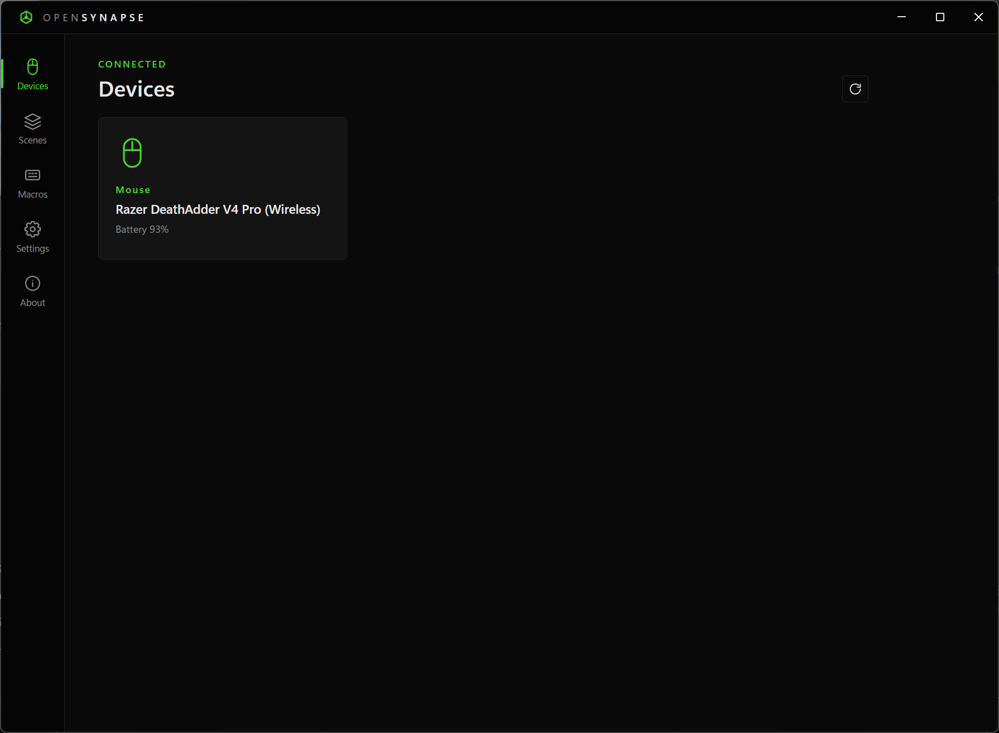
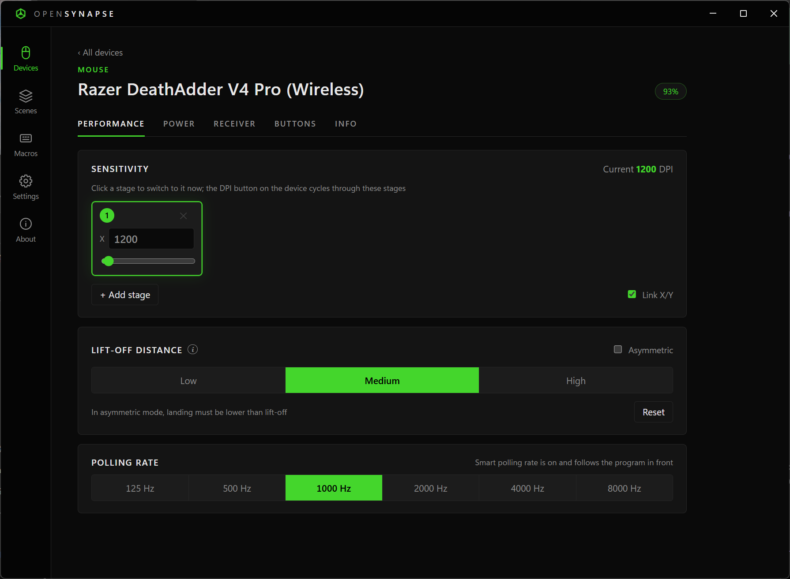
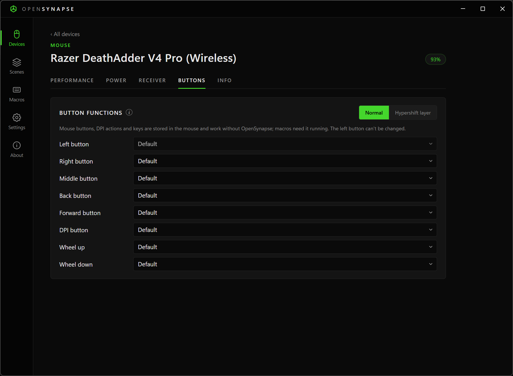
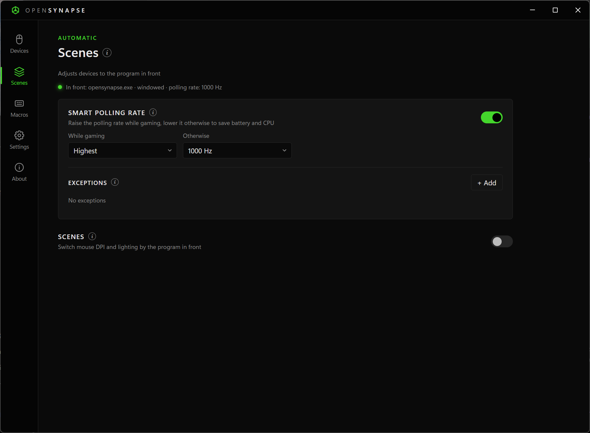
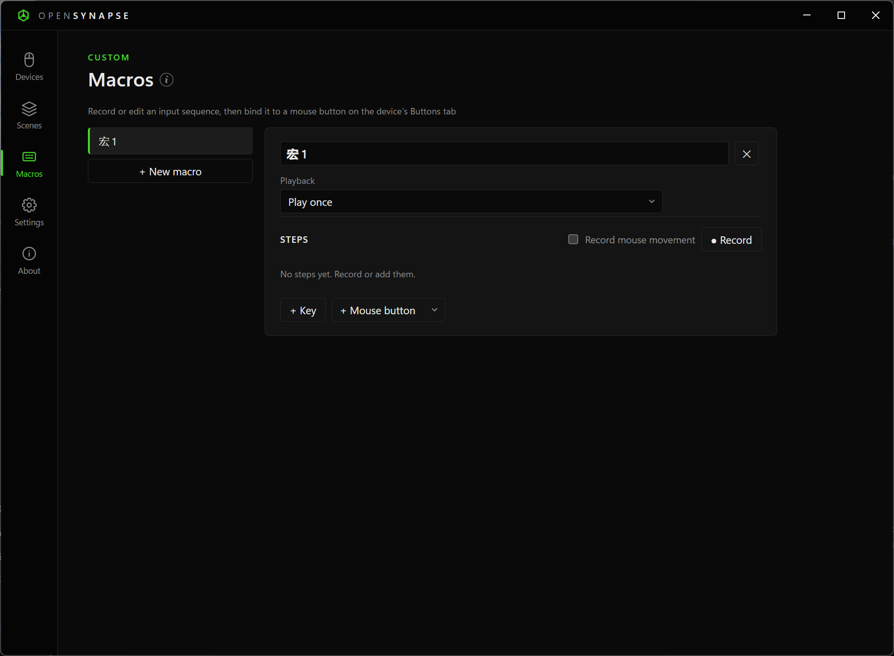
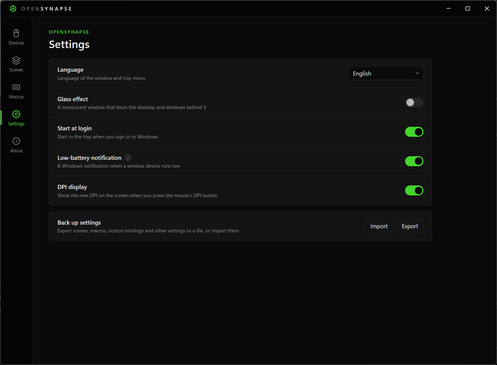
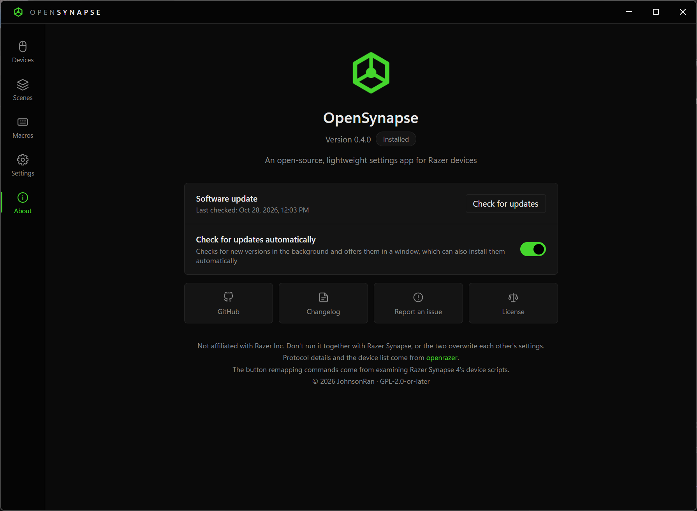
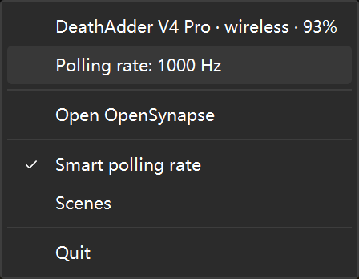

# OpenSynapse

**English** · [简体中文](docs/README.zh-CN.md) · [日本語](docs/README.ja.md)

A lightweight, open-source settings app for Razer mice and other Razer devices on Windows. Set DPI, lighting, polling rate and power options, put macros on mouse buttons, and let your devices adjust themselves to the game or program you're using, without running Razer Synapse.

OpenSynapse is not affiliated with Razer Inc.

## Why OpenSynapse

- **Light on your PC.** In the background, OpenSynapse is a single small process that uses about 20–30 MB of memory. The settings window is loaded only while it's open, and closing it frees all of its memory.
- **No account, no cloud.** Everything stays on your PC. OpenSynapse doesn't connect to the internet.
- **Adapts to what you're doing.** Raise the polling rate when a game starts, switch DPI and lighting for specific programs, and go back to your usual settings afterward.

> [!IMPORTANT]
> Quit Razer Synapse before you use OpenSynapse. Both apps write the same device settings and will overwrite each other.

<details>
<summary><b>Screenshots</b></summary>

| Devices | Device settings |
| :---: | :---: |
|  |  |
| **Buttons** | **Scenes** |
|  |  |
| **Macros** | **Settings** |
|  |  |
| **About and updates** | **Tray menu** |
|  |  |

</details>

## Get started

1. Make sure you're on 64-bit Windows 10 or Windows 11 with the [Microsoft Edge WebView2 Runtime](https://developer.microsoft.com/microsoft-edge/webview2/) installed (it comes with Windows 11 and up-to-date Windows 10).
2. Download OpenSynapse from [Releases](https://github.com/JohnsonRan/OpenSynapse/releases/latest), as either:
   - the **installer**, `opensynapse-setup-<version>-amd64.exe`, which installs for your account only and needs no administrator rights. To download and install it in one step, run this in PowerShell instead:

     ```powershell
     irm https://github.com/JohnsonRan/OpenSynapse/releases/latest/download/install.ps1 | iex
     ```

   - the **portable version**, `opensynapse-<version>-windows-amd64-portable.zip`. Extract the `OpenSynapse` folder to a place you can write to, such as your Documents, and run `OpenSynapse.exe`. It keeps its settings in that folder.

   You can also [build it yourself](#build-from-source).
3. Open OpenSynapse. Every connected device appears as a card on the **Devices** page. Select a card to change its settings.

If a device is missing, turn it on, plug in its receiver, quit Razer Synapse, and then select **Scan again**.

Closing the window keeps OpenSynapse running in the notification area (system tray). To quit, right-click the tray icon and select **Quit**.

## What you can do

### Device settings

- **Sensitivity:** up to 5 DPI stages with separate X/Y values, or a single DPI value. The DPI button on the mouse cycles through your stages.
- **Lighting:** off, static, breathing, spectrum or wave (depending on the device), plus color and brightness.
- **Polling rate:** 125–8000 Hz. For wireless mice, the mouse and its receiver are both updated.
- **Power:** battery level, charging state, sleep timeout and low-battery threshold.
- **Receiver indicators:** on HyperPolling receivers, choose what each of the three lights shows: battery, connection, polling rate or DPI.
- **Lift-off distance:** low, medium or high, or separate distances for lifting and landing (asymmetric).
- **Buttons:** turn any button except the left one into another mouse button, a DPI action (up, down, cycle) or a key or key combination. A button set to **Hypershift** gives the other buttons a second set of functions while it's held, chosen on the **Hypershift layer**. These are stored in the mouse and work without OpenSynapse. Buttons can also play [macros](#macros).
- **Info:** the firmware version and serial number, with links to Razer's firmware updater and, for mice with a receiver, a search for its pairing utility. Pairing itself needs a Razer pairing utility or Razer Synapse.

Each device shows only the settings it supports. Plugging in, unplugging and switching a wireless mouse between cable and receiver are picked up within a few seconds.

### Macros

Create macros on the **Macros** page, and then bind them to mouse buttons.

- **Record:** select **● Record** and press keys and mouse buttons. The delays between presses are recorded too, and so is mouse movement if you check **Record mouse movement**. Select **■ Stop** when you're done.
- **Edit:** add presses by hand with **+ Key** or **+ Mouse button**, which also adds wheel notches and mouse movement, change the delay of each step (in milliseconds), and delete steps you don't need.
- **Playback:** **Play once**, **Repeat a number of times**, **Loop until pressed again** or **Loop while held**.
- **Bind to a button:** on the device page, open the **Buttons** tab and choose a macro for any button except the left one. Choose **Default** to give a button its original function back.

The **Buttons** tab appears only on mice that support button remapping. So far, it has been tested only on the DeathAdder V4 Pro.

> [!NOTE]
> Macros are played by OpenSynapse on your PC, not stored on the mouse, so they work only while OpenSynapse is running. When it quits, bound buttons get their original function back, and the bindings return the next time it starts. Some games' anti-cheat software may block macros.

### Automatic switching

Go to the **Scenes** page, or right-click the tray icon, to turn these on.

- **Smart polling rate:** your mice use a higher rate while you're in a game and a lower one otherwise, which saves battery and CPU. You can also fix the rate for specific programs. **Highest** means each mouse's own maximum.
- **Scenes:** change mouse DPI, device lighting, the audio dongle's EQ preset, the default playback and recording devices and the playback volume based on the program in front. Anything set to **Keep current** is left alone; the EQ, sound devices and volume go back to how they were once you leave the scene, and a scene's EQ is never saved in the dongle. OpenSynapse picks a scene in this order:
  1. **Your own scenes**, matched by program file name (for example, `obs64.exe`).
  2. **Game**, used when a game is detected. Add games it misses, such as windowed games, under **Programs**.
  3. **Desktop**, used for everything else. It also restores your settings when you leave another scene, so lighting set here keeps all your devices in sync.

A program needs to stay in front for about 2 seconds before OpenSynapse switches. Settings you change by hand are replaced at the next switch.

**How games are detected:** a fullscreen or borderless-fullscreen window whose program uses at least 15% of the GPU's 3D engine. Browsers and video players are never treated as games.

### Notifications and tray

- **Low-battery notification:** a Windows notification when a wireless device reaches its warning level (20% if the device has none). You're notified once per discharge.
- Hover over the tray icon to see the active scene and the battery level of each device.
- **Start at login** starts OpenSynapse in the tray when you sign in to Windows.
- The app is available in English, Simplified Chinese and Japanese, and follows your Windows language by default. Change it under **Settings** > **Language**.
- **Glass effect** (under **Settings**, Windows 11 22H2 or later) makes the window translucent, blurring the desktop and windows behind it.
- **DPI display** (under **Settings**) shows the new DPI near the bottom of the screen when you press the mouse's DPI button.
- **Sound devices** (under **Settings**) switches the default playback and recording devices, and sets the default format, bit depth and sample rate, of every playback device, as Sound settings > device properties > Advanced does.
- **Back up settings** (under **Settings**) exports scenes, macros, button bindings and other settings to a file, and imports them, for example on another PC.

### Audio dongles

On a supported USB audio dongle (see [Supported devices](#supported-devices)), the device page has two tabs:

- **Equalizer:** a 10-band parametric EQ (peak, low shelf and high shelf), with a preamp and a live response curve. Pick a built-in preset (flat, bass boost, treble boost, vocal, FPS games) or save your own; your presets are included when you back up settings. The EQ is stored in the dongle, so it also applies on other computers and phones.
- **Audio:** the **default format** Windows plays to the dongle (bit depth and sample rate, as in Sound settings), the DAC's digital filter, high gain, the amplifier mode (class AB or H) and the microphone gain.

### Updates

The installed and the portable version update themselves. When **Check for updates automatically** is on (on the **About** page), OpenSynapse checks for a new version in the background and shows it in a window with its release notes, where you can install it, skip it or be reminded later. That window can also install updates without asking; they take effect the next time OpenSynapse starts. Select **Check for updates** to check right away.

Updates are signed, and OpenSynapse installs only updates signed by this project.

## Supported devices

OpenSynapse knows about 210 Razer mice, keyboards, mouse mats and accessories (laptops aren't supported). The device list comes from the [openrazer](https://github.com/openrazer/openrazer) project.

It also supports USB audio dongles built on WalkPlay chips that share the EPZ TP35 Pro's firmware family (10-band EQ), from brands such as EPZ, Moondrop, Tanchjim and CrinEar; only the TP35 Pro has been tried. Other WalkPlay families aren't enabled yet.

The **LEOBOG Hi75** keyboard is supported on its cable: lighting effects, per-key colors, music lighting, remapping keys (to other keys, media keys or macros) on the normal and Fn layers, and scenes can switch its lighting.

About 110 other keyboards on the same Sinowealth BY-520 firmware are recognized by the model number they report, from brands such as LEOBOG, AULA, Redragon, YUNZII, Machenike, AJAZZ, FURYCUBE and E-YOOSO. They get lighting effects, per-key colors and music lighting; remapping keys and the factory reset stay off, because their factory keymaps aren't known.

Keyboards running QMK with VIA are supported too: the 2,029 models in VIA's keyboard list, Keychron's among them, and the WOBKEY Rainy 75 from WOBKEY's own definitions. Where several keyboards share USB IDs, the one whose name matches what the keyboard reports is taken, and the others can be picked next to its name on its page. Their keys can be remapped on the normal and Fn layers (to other keys, media keys or macros), and their lighting effect, brightness, speed and color can be set. Per-key colors, music lighting and scenes aren't available for them. None has been tested yet.

Keyboards on EVision firmware (rebranded Sonix chips, used by Redragon, AJAZZ, VGN, MageGee and others) get their lighting effect, brightness, speed and color. The newer V2 firmware is recognized by its answer to a request; the first version only on the 13 keyboards OpenRGB lists. Keys can't be remapped on them, and none has been tested yet.

So far, only the **DeathAdder V4 Pro**, the **EPZ TP35 Pro** and the **LEOBOG Hi75** have been tested on real hardware. Other devices should work but haven't been verified. If you try one, please report how it went.

## FAQ

**Why doesn't the app show the lighting effect my device is using?**
Razer devices can't report their current effect, so OpenSynapse shows the last effect you set in OpenSynapse.

**Can I change the color of the receiver indicators?**
No. The color is set by the firmware and the public protocol can't change it.

**My settings changed by themselves.**
If Smart polling rate or Scenes is on, OpenSynapse changes settings when you switch programs. Turn them off on the **Scenes** page or from the tray menu. Also make sure Razer Synapse isn't running.

**How do macros work?**
A bound button is set on the mouse to send an unused key (F13–F24). OpenSynapse catches that key and plays the macro by simulating keyboard and mouse input.

**Why doesn't my macro work in a game?**
Some games' anti-cheat software blocks simulated input. Also make sure OpenSynapse is running, because macros don't work without it.

**A mouse button stopped working.**
If OpenSynapse crashed or was ended from Task Manager, a button bound to a macro keeps sending its F13–F24 key, which does nothing on its own. Start OpenSynapse again and the button works again. To give the button its original function back for good, set it to **Default** on the **Buttons** tab.

**Where are my settings stored?**
In `%APPDATA%\OpenSynapse\config.json`, or for the portable version in `config.json` in its folder.

## Build from source

Requirements: Go 1.27.3 or later, and [Bun](https://bun.sh).

```sh
bun install
bun run dev        # run with live reload
bun run build      # build/windows-amd64/OpenSynapse.exe and the installer
go test ./...
go run ./cmd/probe # print device state (read-only)

# regenerate the device list from an openrazer checkout
uv run --no-project python scripts/gendevices.py ../openrazer
```

To release, add a section for the version to `CHANGELOG.md` (in Simplified Chinese, English and Japanese), set `version` in `package.json`, and push the tag `v<version>`. The release workflow builds the installer and the portable zip, signs the updates with the `MYGO_UPDATER_PRIVATE_KEY` secret, and publishes the release.

The app is written in Go, with a [MyGo](https://github.com/egoist/mygo) WebView2 window. The device list in `internal/razer/data/devices.json` is generated from openrazer by `scripts/gendevices.py`.

## Credits

- Protocol details and the device list come from [openrazer](https://github.com/openrazer/openrazer) (GPL-2.0). The protocol was reimplemented here; no openrazer code is copied.
- The audio dongle protocol follows the WalkPlay app as documented by [devicePEQ](https://github.com/jeromeof/devicePEQ) (ISC). No devicePEQ code is copied.
- The LEOBOG keyboard protocol was recorded from the official LEOBOG ONE driver's own requests to the keyboard.
- The EVision keyboard protocol follows [OpenRGB](https://gitlab.com/CalcProgrammer1/OpenRGB)'s EVision controllers (GPL-2.0-or-later). No OpenRGB code is copied.
- The VIA protocol follows QMK (GPL-2.0). The VIA keyboard list and key layouts come from [the-via/keyboards](https://github.com/the-via/keyboards) and are parsed with [@the-via/reader](https://github.com/the-via/reader) at build time (both GPL-3.0); because of them, builds are distributed under GPL-3.0, which OpenSynapse's GPL-2.0-or-later license allows.
- The list of other BY-520 keyboards (model numbers, key matrices, effects and key layouts) comes from the tables of [Let Me Drive](https://letmedrive.cn), which collected them from the vendors' drivers. Only the data is used; none of its code is copied.
- The button remapping commands were identified by examining the device scripts included with Razer Synapse 4.
- The interface borrows only the general look of Razer Synapse (dark theme, green accent). All icons and artwork are original.

## License

GPL-2.0-or-later. See [LICENSE](LICENSE).
