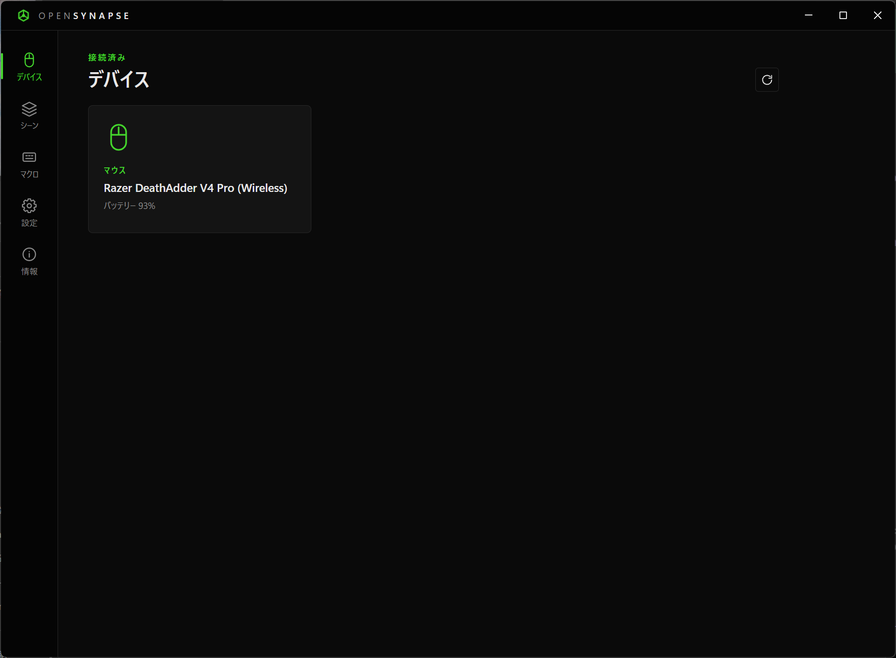
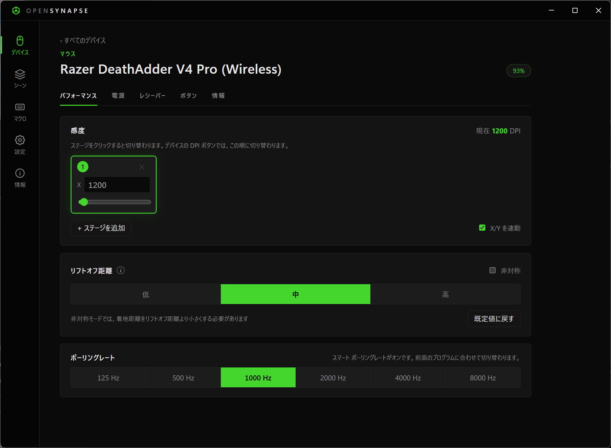
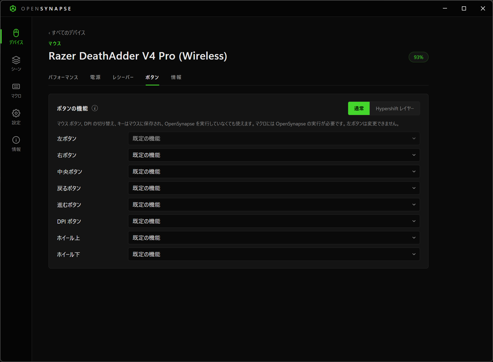
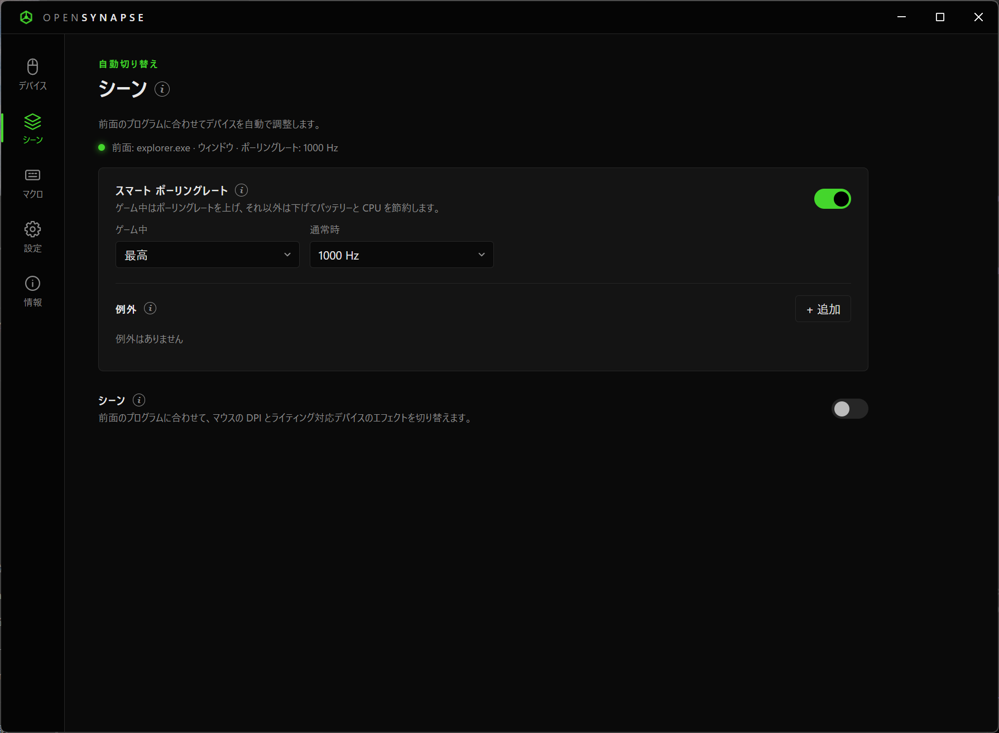
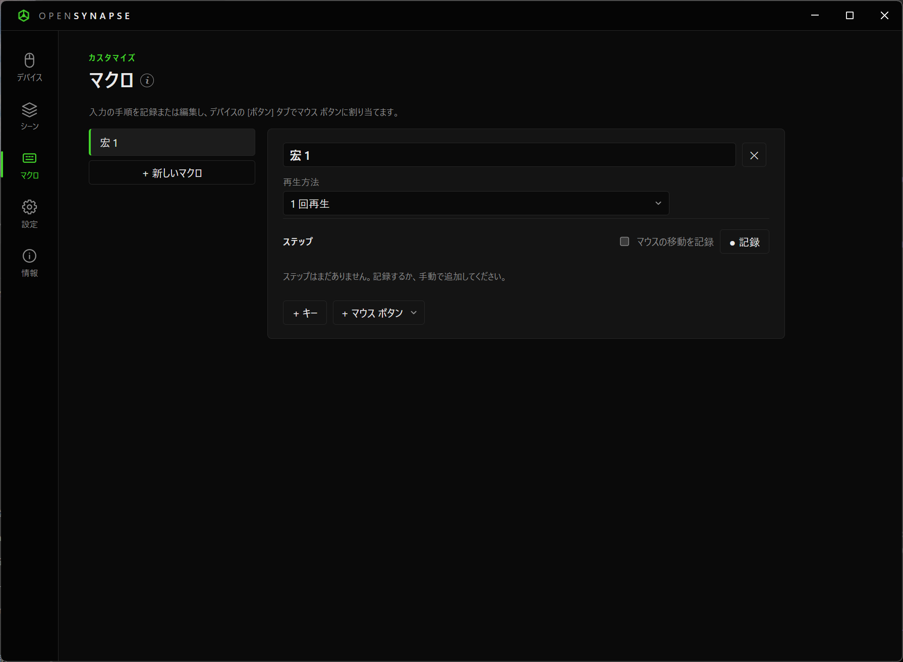
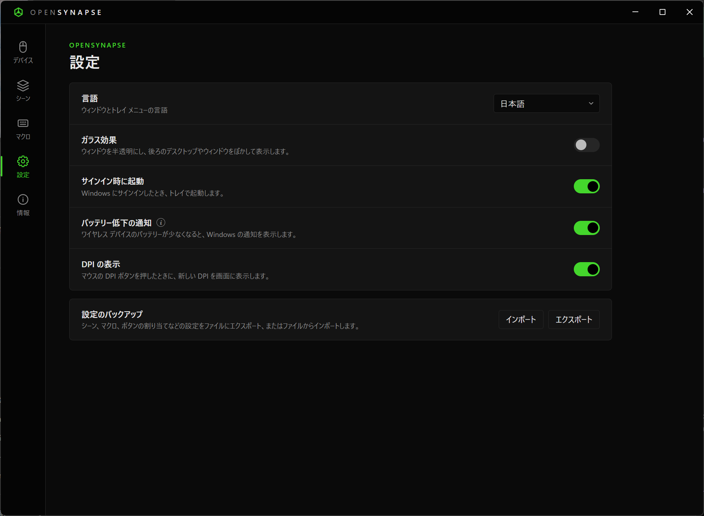
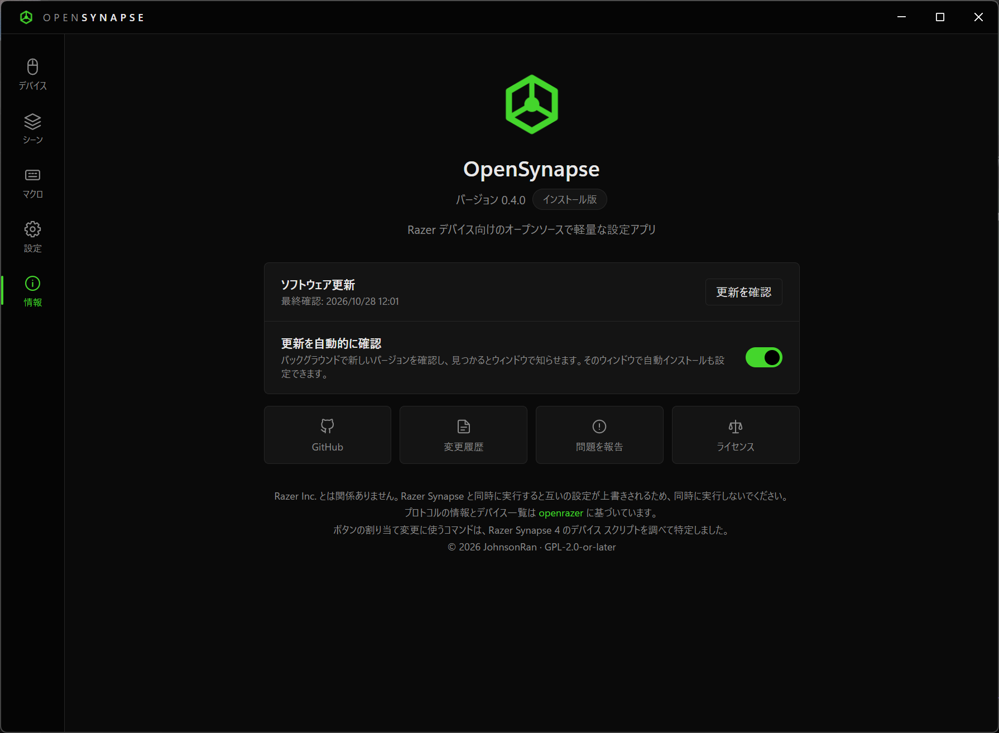
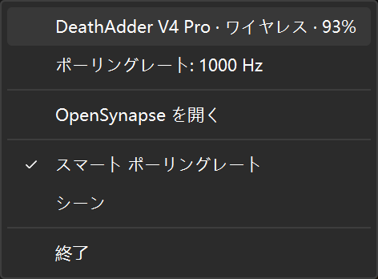

# OpenSynapse

[English](../README.md) · [简体中文](README.zh-CN.md) · **日本語**

Windows 用の軽量でオープンソースな Razer マウス・Razer デバイス設定アプリです。Razer Synapse を使わずに DPI、ライティング、ポーリングレート、電源設定を変更したり、マウスのボタンにマクロを割り当てたりできます。使用中のゲームやプログラムに合わせてデバイスを自動で切り替えることもできます。

OpenSynapse は Razer Inc. とは関係ありません。

## 特長

- **PC への負荷が小さい。**バックグラウンドでは小さなプロセスが 1 つ動くだけで、メモリ使用量は約 20～30 MB です。設定ウィンドウは開いている間だけ読み込まれ、閉じるとメモリはすべて解放されます。
- **アカウント不要、通信なし。**データはすべて PC 内に保存されます。OpenSynapse はインターネットに接続しません。
- **使い方に合わせて自動調整。**ゲームを始めるとポーリングレートを上げ、特定のプログラムでは DPI やライティングを切り替え、終わったら普段の設定に戻します。

> [!IMPORTANT]
> OpenSynapse を使う前に Razer Synapse を終了してください。両方のアプリが同じデバイス設定を書き込むため、互いの設定を上書きしてしまいます。

<details>
<summary><b>スクリーンショット</b></summary>

| デバイス | デバイスの設定 |
| :---: | :---: |
|  |  |
| **ボタン** | **シーン** |
|  |  |
| **マクロ** | **設定** |
|  |  |
| **情報と更新** | **トレイ メニュー** |
|  |  |

</details>

## はじめに

1. 64 ビット版の Windows 10 または Windows 11 で、[Microsoft Edge WebView2 ランタイム](https://developer.microsoft.com/microsoft-edge/webview2/)がインストールされていることを確認します（Windows 11 と最新の Windows 10 には標準で含まれています）。
2. [Releases](https://github.com/JohnsonRan/OpenSynapse/releases/latest) から、次のいずれかをダウンロードします。
   - **インストーラー版** `opensynapse-setup-<バージョン>-amd64.exe`：現在のユーザーにのみインストールされ、管理者権限は不要です。PowerShell で次のコマンドを実行して、ダウンロードとインストールを一度に行うこともできます。

     ```powershell
     irm https://github.com/JohnsonRan/OpenSynapse/releases/latest/download/install.ps1 | iex
     ```

   - **ポータブル版** `opensynapse-<バージョン>-windows-amd64-portable.zip`：`OpenSynapse` フォルダーを書き込み可能な場所（ドキュメントなど）に展開し、`OpenSynapse.exe` を実行します。設定はそのフォルダーに保存されます。

   [ソースからビルド](#ソースからビルド)することもできます。
3. OpenSynapse を開きます。接続されているデバイスは [**デバイス**] ページにカードとして表示されます。カードを選択すると設定を変更できます。

デバイスが表示されない場合は、デバイスの電源を入れてレシーバーを接続し、Razer Synapse を終了してから [**再スキャン**] を選択してください。

ウィンドウを閉じても、OpenSynapse は通知領域（システム トレイ）で動き続けます。終了するには、トレイ アイコンを右クリックして [**終了**] を選択します。

## できること

### デバイスの設定

- **感度：**最大 5 段階の DPI ステージ（X/Y 個別設定可）、または単一の DPI 値。マウスの DPI ボタンを押すと、ステージが順番に切り替わります。
- **ライティング：**オフ、スタティック、ブリージング、スペクトラム、ウェーブ（デバイスによって異なります）と、色と明るさ。
- **ポーリングレート：**125～8000 Hz。ワイヤレス マウスでは、マウスとレシーバーの両方が設定されます。
- **電源：**バッテリー残量、充電状態、スリープまでの時間、バッテリー低下のしきい値。
- **レシーバーのインジケーター：**HyperPolling レシーバーの 3 つのランプに、それぞれ何を表示するか（バッテリー、接続状態、ポーリングレート、DPI）を選べます。
- **リフトオフ距離：**低、中、高、または持ち上げと着地の距離を別々に設定（非対称）。
- **ボタン：**左ボタン以外のボタンを、別のマウス ボタン、DPI の切り替え（上げる、下げる、順に切り替え）、キーやキーの組み合わせに変更できます。[**Hypershift**] に設定したボタンを押している間は、ほかのボタンが [**Hypershift レイヤー**] で設定した 2 つ目の機能になります。これらはマウスに保存され、OpenSynapse を実行していなくても使えます。ボタンで[マクロ](#マクロ)を再生することもできます。
- **情報：**ファームウェア バージョンとシリアル番号。Razer のファームウェア アップデーターへのリンクと、レシーバー付きのマウスではペアリング ユーティリティを検索できます。ペアリング自体には Razer のペアリング ユーティリティまたは Razer Synapse が必要です。

各デバイスには、そのデバイスが対応している設定だけが表示されます。デバイスの抜き差しや、ワイヤレス マウスのケーブル接続とレシーバー接続の切り替えは、数秒以内に認識されます。

### マクロ

[**マクロ**] ページでマクロを作成し、マウスのボタンに割り当てます。

- **記録：**[**● 記録**] を選択してキーやマウス ボタンを押します。押す間隔も一緒に記録されます。[**マウスの移動を記録**] をオンにすると、マウスの移動も記録されます。終わったら [**■ 停止**] を選択します。
- **編集：**[**+ キー**] や [**+ マウス ボタン**] で入力を手動で追加したり (後者ではホイールやマウスの移動も追加できます)、各ステップの待ち時間（ミリ秒）を変更したり、不要なステップを削除したりできます。
- **再生方法：**[**1 回再生**]、[**指定回数繰り返す**]、[**もう一度押すまで繰り返す**]、[**押している間繰り返す**] から選べます。
- **ボタンへの割り当て：**デバイス ページの [**ボタン**] タブで、左ボタン以外の任意のボタンにマクロを選択します。[**既定の機能**] を選ぶとボタンが元の機能に戻ります。

[**ボタン**] タブは、ボタンの割り当て変更に対応したマウスでのみ表示されます。現在、テスト済みなのは DeathAdder V4 Pro のみです。

> [!NOTE]
> マクロはマウスに保存されるのではなく、PC 上で OpenSynapse が再生します。そのため、OpenSynapse の実行中しか動作しません。OpenSynapse を終了すると割り当てたボタンは元の機能に戻り、次回起動時に割り当てが復元されます。ゲームによっては、チート対策ソフトウェアがマクロをブロックする場合があります。

### 自動切り替え

[**シーン**] ページ、またはトレイ アイコンの右クリック メニューから有効にします。

- **スマート ポーリングレート：**ゲーム中は高いポーリングレート、それ以外は低いポーリングレートを使い、バッテリーと CPU を節約します。特定のプログラムにだけ固定のレートを設定することもできます。[**最高**] は各マウスの最大値を表します。
- **シーン：**前面のプログラムに合わせて、マウスの DPI、デバイスのライティング、オーディオ ドングルの EQ プリセット、既定の再生デバイスと録音デバイス、再生音量を切り替えます。[**現在の設定を維持**] にした項目は変更されません。EQ、サウンド デバイス、音量はシーンを離れると元の状態に戻り、シーンの EQ がドングルに保存されることはありません。シーンは次の順序で選ばれます。
  1. **自分で作ったシーン**：プログラムのファイル名（例：`obs64.exe`）で一致したもの。
  2. **ゲーム**：ゲームが検出されたときに使われます。ウィンドウ モードのゲームなど、検出されないゲームは [**プログラム**] に追加できます。
  3. **デスクトップ**：上のどれにも当てはまらないときに使われます。ほかのシーンから戻るときの設定の復元にも使われるため、ここでライティングを設定するとすべてのデバイスの見た目をそろえられます。

プログラムが約 2 秒間前面にあると切り替わります。手動で変更した設定は、次の切り替え時に上書きされます。

**ゲームの検出方法：**フルスクリーンまたはボーダーレス フルスクリーンのウィンドウで、そのプログラムが GPU の 3D エンジンを 15% 以上使っている場合にゲームと判断します。ブラウザーと動画プレーヤーはゲームとして扱いません。

### 通知とトレイ

- **バッテリー低下の通知：**ワイヤレス デバイスの残量が警告レベル（設定がないデバイスは 20%）まで下がると、Windows の通知を 1 回表示します。
- トレイ アイコンにマウス ポインターを合わせると、現在のシーンと各デバイスのバッテリー残量を確認できます。
- [**サインイン時に起動**] を有効にすると、Windows へのサインイン時に OpenSynapse がトレイで起動します。
- 表示言語は日本語、英語、中国語（簡体字）から選べます。既定では Windows の言語に従い、[**設定**] > [**言語**] で変更できます。
- [**設定**] の [**ガラス効果**]（Windows 11 22H2 以降）をオンにすると、ウィンドウが半透明になり、後ろのデスクトップやウィンドウがぼかして表示されます。
- [**設定**] の [**DPI の表示**] をオンにすると、マウスの DPI ボタンを押したときに新しい DPI が画面下部に表示されます。
- [**設定**] の [**サウンド デバイス**] では、既定の再生デバイスと録音デバイスを切り替えられるほか、各再生デバイスの既定の形式 (ビット深度とサンプル レート) を設定できます。Windows のサウンド設定で、デバイスのプロパティの [詳細] タブと同じ設定です。
- [**設定**] の [**設定のバックアップ**] では、シーン、マクロ、ボタンの割り当てなどの設定をファイルにエクスポートしたり、別の PC などでインポートしたりできます。

### USB オーディオ ドングル

対応している USB オーディオ ドングル ([対応デバイス](#対応デバイス) を参照) では、デバイス ページに 2 つのタブがあります。

- **イコライザー:** 10 バンドのパラメトリック EQ (ピーク、ローシェルフ、ハイシェルフ) です。プリアンプと、周波数特性のカーブも表示されます。組み込みのプリセット (フラット、低音強調、高音強調、ボーカル、FPS ゲーム) を選べるほか、自分のプリセットも保存できます。保存したプリセットは設定のバックアップにも含まれます。EQ はドングルに保存されるため、ほかのパソコンやスマートフォンでも有効です。
- **オーディオ:** Windows がドングルに出力する**既定の形式** (ビット深度とサンプル レート。Windows のサウンド設定と同じもの)、DAC のデジタル フィルター、ハイ ゲイン、アンプ モード (AB 級または H 級)、マイク ゲインを設定できます。

### 更新

インストーラー版とポータブル版はどちらも自動で更新できます。[**情報**] ページの [**更新を自動的に確認**] をオンにすると、OpenSynapse はバックグラウンドで新しいバージョンを確認し、見つかるとリリース ノートをウィンドウで表示します。インストール、スキップ、後で通知から選べます。このウィンドウで、確認せずに自動でインストールするようにも設定できます。更新は次回 OpenSynapse を起動したときに反映されます。すぐに確認するには [**更新を確認**] を選択します。

更新には署名が付いており、OpenSynapse はこのプロジェクトが署名した更新だけをインストールします。

## 対応デバイス

約 210 種類の Razer マウス、キーボード、マウスパッド、アクセサリーを認識します（ノート PC には対応していません）。デバイスの一覧は [openrazer](https://github.com/openrazer/openrazer) プロジェクトに基づいています。

WalkPlay チップを搭載し、EPZ TP35 Pro と同じファームウェア系列 (10 バンド EQ) の USB オーディオ ドングルにも対応しています。EPZ、Moondrop、TANCHJIM、CrinEar などのブランドが該当しますが、実際に試したのは TP35 Pro のみです。ほかの WalkPlay ファームウェア系列はまだ有効にしていません。

**LEOBOG Hi75** キーボードは有線接続で使えます。ライティング エフェクト、キーごとの色、音楽ライティング、通常レイヤーと Fn レイヤーでのキーの割り当て変更 (ほかのキー、メディア キー、マクロ) に対応し、シーンでライティングを切り替えることもできます。

現在、実機でテストしたのは **DeathAdder V4 Pro**、**EPZ TP35 Pro**、**LEOBOG Hi75** のみです。ほかのデバイスも動作するはずですが、確認はできていません。試した方はぜひ結果をお知らせください。

## よくある質問

**表示されているライティング効果が、デバイスの実際の効果と違うのはなぜですか？**
Razer デバイスは現在の効果を報告できないため、OpenSynapse で最後に設定した効果を表示しています。

**レシーバーのインジケーターの色は変えられますか？**
いいえ。色はファームウェアで決まっており、公開されているプロトコルでは変更できません。

**設定が勝手に変わります。**
スマート ポーリングレートやシーンが有効な場合、プログラムを切り替えると OpenSynapse が設定を変更します。[**シーン**] ページまたはトレイ メニューで無効にできます。また、Razer Synapse が起動していないことも確認してください。

**マクロはどのように動作しますか？**
割り当てたボタンは、マウス側で未使用のキー（F13～F24）を送るように設定されます。OpenSynapse がこのキーを受け取り、キーボードとマウスの入力をシミュレートしてマクロを再生します。

**ゲームでマクロが動作しないのはなぜですか？**
ゲームによっては、チート対策ソフトウェアがシミュレートされた入力をブロックします。また、マクロは OpenSynapse が起動していないと動作しないため、起動していることを確認してください。

**マウスのボタンが反応しなくなりました。**
OpenSynapse がクラッシュしたり、タスク マネージャーで終了されたりした場合、マクロを割り当てたボタンは F13～F24 のいずれかのキーを送り続けますが、このキー自体には何の動作もありません。OpenSynapse をもう一度起動すると元どおり使えるようになります。ボタンを元の機能に戻したい場合は、[**ボタン**] タブで [**既定の機能**] に設定してください。

**設定はどこに保存されますか？**
`%APPDATA%\OpenSynapse\config.json` に保存されます。ポータブル版では、そのフォルダー内の `config.json` に保存されます。

## ソースからビルド

必要なもの：Go 1.27.3 以降、[Bun](https://bun.sh)

```sh
bun install
bun run dev        # ライブ リロードで実行
bun run build      # build/windows-amd64/OpenSynapse.exe とインストーラーを生成
go test ./...
go run ./cmd/probe # デバイスの状態を表示（読み取りのみ）

# openrazer のソースからデバイス一覧を再生成
uv run --no-project python scripts/gendevices.py ../openrazer
```

リリースするには、`CHANGELOG.md` にそのバージョンのセクション（簡体字中国語、英語、日本語）を追加し、`package.json` の `version` を更新して、タグ `v<バージョン>` をプッシュします。リリース ワークフローがインストーラーとポータブル版の zip をビルドし、`MYGO_UPDATER_PRIVATE_KEY` シークレットで更新に署名して、リリースを公開します。

本アプリは Go で書かれており、ウィンドウには [MyGo](https://github.com/egoist/mygo) と WebView2 を使っています。`internal/razer/data/devices.json` のデバイス一覧は、`scripts/gendevices.py` で openrazer から生成しています。

## クレジット

- プロトコルの情報とデバイス一覧は [openrazer](https://github.com/openrazer/openrazer)（GPL-2.0）に基づいています。プロトコルは本プロジェクトで新たに実装したもので、openrazer のコードは含まれていません。
- USB オーディオ ドングルのプロトコルは、[devicePEQ](https://github.com/jeromeof/devicePEQ) (ISC) がまとめた WalkPlay アプリの資料に基づいています。devicePEQ のコードは含まれていません。
- LEOBOG キーボードのプロトコルは、公式ドライバー LEOBOG ONE がキーボードに送る要求を記録して特定しました。
- ボタンの割り当て変更に使うコマンドは、Razer Synapse 4 に付属するデバイス スクリプトを調べて特定しました。
- 画面デザインは Razer Synapse の全体的な雰囲気（ダーク テーマ、緑のアクセント カラー）のみを参考にしています。アイコンと画像はすべてオリジナルです。

## ライセンス

GPL-2.0-or-later です。詳しくは [LICENSE](../LICENSE) をご覧ください。
